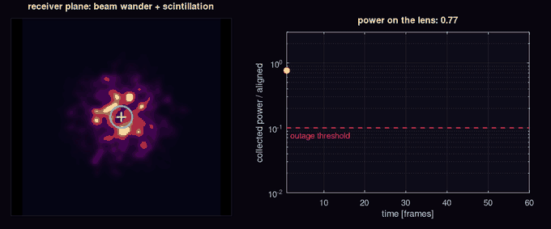
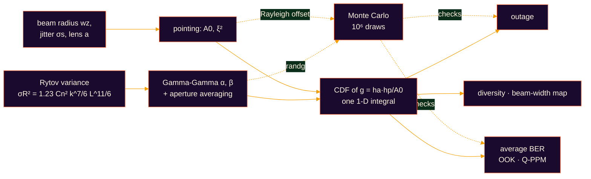
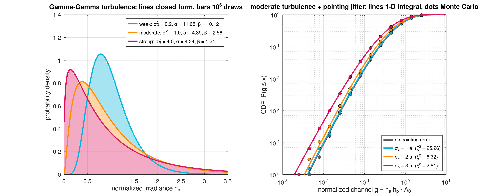
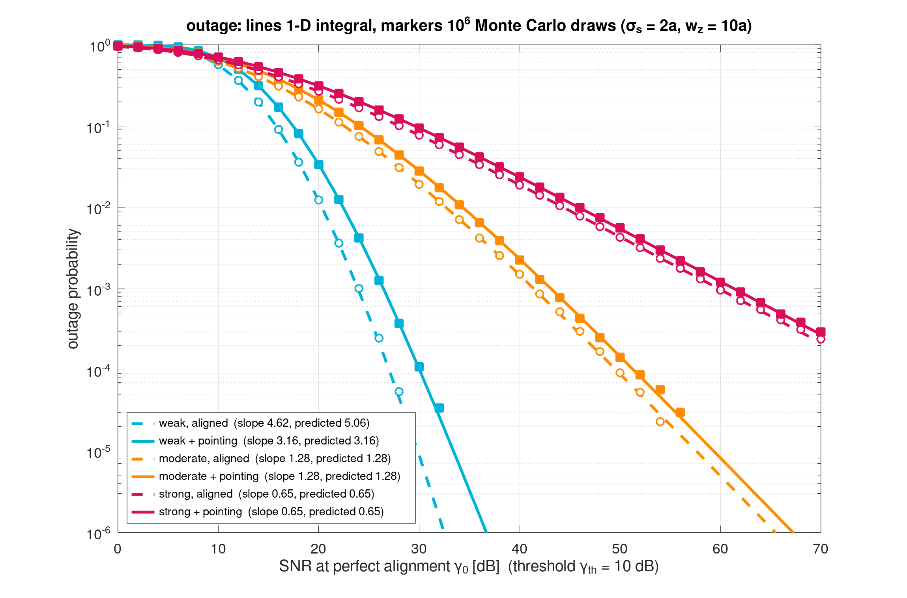
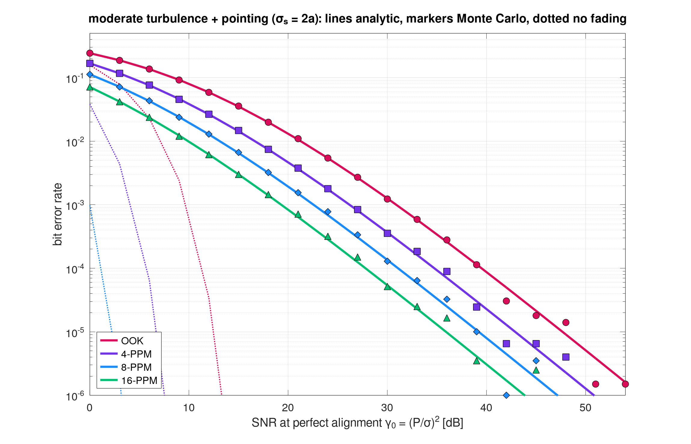
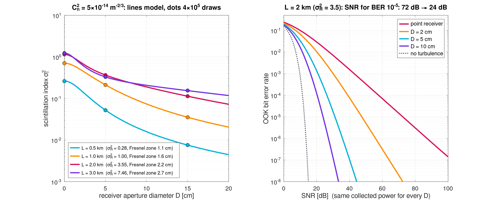
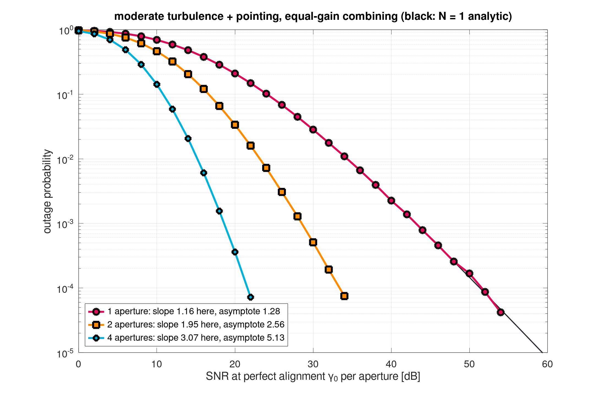
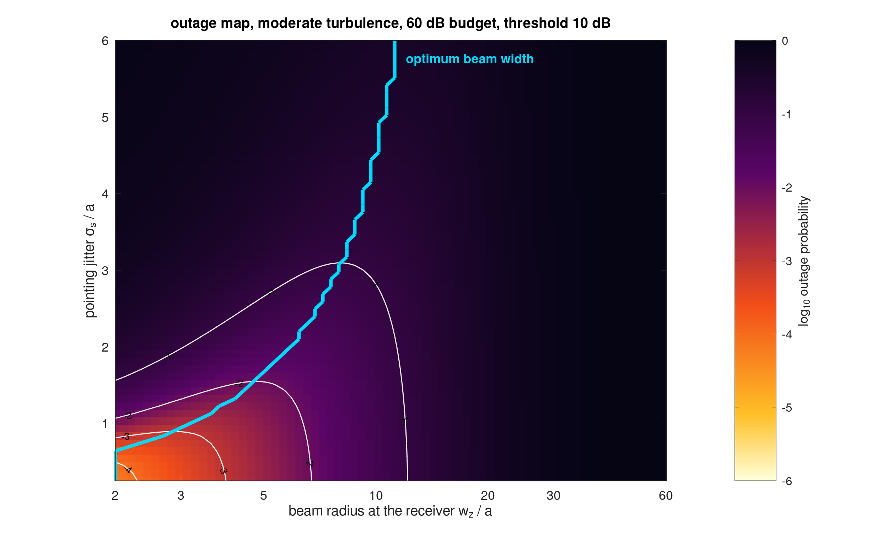

<p align="center"></p>

<p align="center">


</p>

<h3 align="center">A laser link between two rooftops fails for two reasons: the air twinkles and the buildings sway.<br>This repository models both, checks every formula against a million random draws, and finds the best beam width.</h3>

**Free-space optics (FSO)** sends data on an infrared laser beam through open air: gigabits per second, no spectrum licence, no trench for a fibre. Its enemies are not noise but the atmosphere and the mounts:

* **Turbulence.** Small temperature differences in the air bend the beam like a heat haze over a road. The received power *scintillates*, sometimes dropping far below its average. The standard model for that is the **Gamma-Gamma** distribution.
* **Pointing errors.** Buildings sway in the wind and expand in the sun. The beam spot wanders on the receiver lens. A narrow beam delivers more power but falls off the lens more easily.

This repository puts both effects into one channel, $h = h_\ell\, h_a\, h_p$ (path loss × turbulence × pointing), derives its outage probability and bit error rate, and checks each result against a Monte Carlo simulation.

<table>
<tr>
<td align="center" width="25%"><h2>0.706</h2><sub>scintillation index, moderate<br>turbulence: closed form 0.706438,<br>10⁶ draws 0.706436</sub></td>
<td align="center" width="25%"><h2>11.7 dB</h2><sub>saved by 16-PPM over OOK<br>at BER 10⁻⁴, same average power</sub></td>
<td align="center" width="25%"><h2>72 → 24 dB</h2><sub>SNR needed for BER 10⁻⁵ at 2 km:<br>point receiver vs a 10 cm lens</sub></td>
<td align="center" width="25%"><h2>43 → 19 dB</h2><sub>SNR for 10⁻³ outage:<br>1 aperture vs 4 apertures</sub></td>
</tr>
</table>

<p align="center"></p>
<p align="center"><sub>What the receiver sees. Left: the beam footprint (speckled by turbulence, drifting with the wind) moves over the lens (cyan circle) because of pointing jitter. Right: the power the lens collects, against the outage threshold. Illustration with a narrow beam (w<sub>z</sub> = 4a, σ<sub>s</sub> = 1.5a) so the motion is visible.</sub></p>

---

## ☀ Run it

```matlab
>> main                          % MATLAB R2016b or newer, no toolboxes
```
```bash
octave --no-gui --eval main      # GNU Octave 6 or newer
```

About a minute and a half. `main` writes six figures to [`figures/`](figures), every curve as CSV to [`results/`](results), and [`results/summary.txt`](results/summary.txt). The figures and numbers on this page come from running this exact code in **GNU Octave 10.3**. The build machine has no MATLAB licence, so the code uses only base functions that behave the same in both (`randg`, `besselk`, `erf`, `gammaln`).



## ☀ The channel, in five formulas

**Turbulence strength.** For a plane wave over a path of length $L$ at wavenumber $k = 2\pi/\lambda$:

$$\sigma_R^2 = 1.23\, C_n^2\, k^{7/6} L^{11/6}$$

**Gamma-Gamma fading.** The irradiance is the product of two independent unit-mean gamma variables, large eddies times small eddies (Andrews and Phillips):

$$f_{h_a}(h) = \frac{2(\alpha\beta)^{\frac{\alpha+\beta}{2}}}{\Gamma(\alpha)\Gamma(\beta)}\, h^{\frac{\alpha+\beta}{2}-1} K_{\alpha-\beta}\!\left(2\sqrt{\alpha\beta h}\right)$$

$$\alpha = \left[\exp\!\left(\frac{0.49\,\sigma_R^2}{(1+0.65d^2+1.11\sigma_R^{12/5})^{7/6}}\right)-1\right]^{-1},\quad
\beta = \left[\exp\!\left(\frac{0.51\,\sigma_R^2\,(1+0.69\sigma_R^{12/5})^{-5/6}}{(1+0.90d^2+0.62d^2\sigma_R^{12/5})^{5/6}}\right)-1\right]^{-1}$$

with $d^2 = kD^2/(4L)$ for a lens of diameter $D$ ($d = 0$ is a point receiver).

**Pointing errors** (Farid and Hranilovic, 2007). A Gaussian beam of radius $w_z$ on a lens of radius $a$, offset by a Rayleigh-distributed distance with jitter $\sigma_s$:

$$h_p \approx A_0\, e^{-2r^2/w_{z,\text{eq}}^2},\qquad A_0 = \operatorname{erf}^2(v),\quad v = \frac{\sqrt{\pi}\,a}{\sqrt2\,w_z},\qquad \xi = \frac{w_{z,\text{eq}}}{2\sigma_s}$$

**The key step.** For the normalized channel $g = h_a h_p / A_0$, the pointing part has the simple CDF $P(h_p/A_0 \le x) = x^{\xi^2}$ on $[0,1]$. So the CDF of the full channel is a single integral over the closed-form Gamma-Gamma density:

$$F_g(t) = \int_0^\infty \min\!\left(1, \Big(\frac{t}{h}\Big)^{\xi^2}\right) f_{h_a}(h)\, dh$$

Outage probability, average BER and the beam-width map all come from this one function, [`channel_cdf.m`](src/channel_cdf.m). Monte Carlo uses the same physics differently: two `randg` draws for turbulence, and $U^{1/\xi^2}$ with $U$ uniform for pointing.

**High-SNR slope.** For IM/DD the electrical SNR scales as $h^2$, so the outage probability falls as $\text{SNR}^{-\min(\alpha,\beta,\xi^2)/2}$: the weakest of turbulence and pointing sets the slope.

## ☀ Results

The three turbulence regimes used throughout (point receiver, $\lambda$ = 1550 nm, 1 km):

| Regime | $\sigma_R^2$ | α | β | Scintillation index: formula | Monte Carlo (10⁶) |
|:--|--:|--:|--:|--:|--:|
| weak | 0.2 | 11.65 | 10.12 | 0.1931 | 0.1933 |
| moderate | 1.0 | 4.39 | 2.56 | 0.7064 | 0.7064 |
| strong | 4.0 | 4.34 | 1.31 | 1.1705 | 1.1666 |

Pointing: beam radius $w_z = 10a$ at the receiver ($A_0$ = 0.0198, so even perfect alignment catches only 2 % of the beam), jitter $\sigma_s = 2a$ unless stated, giving $\xi^2 = 6.32$.

### 1. The fading

<p align="center"></p>

Left: as turbulence grows the density moves its mass towards zero, which is where the outages come from. The histograms of 10⁶ draws sit on the formulas. Right: adding pointing jitter fattens the low tail (log scale). With $\sigma_s = 3a$ ($\xi^2 = 2.81$) the deep fades are clearly more likely than with turbulence alone.

### 2. Outage probability, and who sets the slope

<p align="center"></p>

Lines are the one-dimensional integral, markers are 10⁶ Monte Carlo draws: they agree everywhere they can be measured. The slopes, measured on the formula deep in the tail (outage 10⁻¹¹ to 10⁻¹⁴):

| Regime | Aligned: slope | min(α, β)/2 | With jitter: slope | min(α, β, ξ²)/2 |
|:--|--:|--:|--:|--:|
| weak | 4.62 | 5.06 | **3.16** | **3.16** |
| moderate | 1.28 | 1.28 | 1.28 | 1.28 |
| strong | 0.654 | 0.654 | 0.654 | 0.654 |

This is the most useful lesson in the repository. **In weak turbulence the pointing jitter decides the slope** (ξ² = 6.32 is smaller than α and β), so a better mount buys more than a better site. **In moderate and strong turbulence β is the bottleneck**, and the same jitter costs only a constant shift, not slope. (Weak and aligned reaches 4.62 at 10⁻¹⁴ and is still approaching 5.06: α and β are almost equal there, so the second term of the tail fades slowly.)

### 3. OOK or PPM?

<p align="center"></p>

At the **same average optical power and bit rate**, Q-PPM sends one pulse $Q$ times stronger in one of $Q$ slots, each slot $\log_2 Q/Q$ of a bit long (so the noise bandwidth grows by $Q/\log_2 Q$). Lines: the conditional BER averaged over $F_g$. Markers: bit-by-bit Monte Carlo, $10^5$ channel draws with 20 symbols each.

| | OOK | 4-PPM | 8-PPM | 16-PPM |
|:--|--:|--:|--:|--:|
| SNR for BER 10⁻⁴ | 39.5 dB | 34.7 dB | 31.1 dB | **27.8 dB** |
| Bandwidth per bit | 1× | 2× | 2.7× | 4× |

16-PPM saves 11.7 dB of power and pays with four times the bandwidth. Below 10⁻⁵ the Monte Carlo markers scatter around the lines: 10⁵ channel draws see few of the deep fades that cause those errors.

### 4. A bigger lens averages the twinkle away

<p align="center"></p>

Left: once the lens is larger than the Fresnel zone $\sqrt{L/k}$ (1.1 to 2.7 cm here), it averages over many independent speckles. At $C_n^2 = 5\times10^{-14}$, a 10 cm lens reduces the scintillation index 16× at 500 m (0.263 → 0.016) and 6× at 3 km (1.24 → 0.21). Right: at 2 km ($\sigma_R^2$ = 3.5), the SNR for BER 10⁻⁵ falls from 72 dB with a point receiver to 47.5 dB (2 cm), 31 dB (5 cm) and 24 dB (10 cm), with the same collected power, so this is the averaging alone. The 2 km and 3 km curves nearly coincide: in strong turbulence the point-receiver scintillation index saturates around 1.1 to 1.3, so the longer link adds little extra twinkle.

### 5. Spatial diversity

<p align="center"></p>

Several apertures far enough apart see independent turbulence and, on separate mounts, independent jitter. With equal-gain combining ($\gamma = \gamma_0(\sum g_n)^2/N$, Tsiftsis et al., 2009) the outage at 10⁻³ needs 43.1 dB with one aperture, 28.5 dB with two and 18.6 dB with four. The slopes in the plotted range (1.16, 1.95, 3.07) are on their way to the asymptotes $N\min(\alpha,\beta,\xi^2)/2$ = 1.28, 2.56, 5.13, which Monte Carlo cannot reach with 10⁶ draws.

### 6. The best beam width

<p align="center"></p>

Fixed transmit budget (60 dB if the whole beam reached the detector), threshold 10 dB, moderate turbulence. A narrow beam puts more of its power on the lens; a wide one survives more sway. The cyan line is the optimum for each jitter:

| Jitter σs/a | Best beam radius wz/a | Outage there |
|--:|--:|--:|
| 0.25 | 2 (edge of the grid) | 6.0·10⁻⁵ |
| 0.83 | 2.7 | 7.2·10⁻⁴ |
| 2.00 | 5.9 | 0.026 |
| 3.17 | 8.4 | 0.107 |
| 5.51 | 11.2 | 0.344 |

The optimum grows roughly linearly with the jitter (about 3σs for moderate jitter, flattening for large jitter, where no width can save the link).

## ☀ Assumptions

* Plane-wave Gamma-Gamma model, valid from weak to moderately strong turbulence; the weak-turbulence log-normal and the saturated negative-exponential limits are not modelled separately.
* IM/DD with thermal (Gaussian, signal-independent) noise and a receiver that knows the channel (adaptive OOK threshold). Shot noise and background light are not modelled.
* Slow fading: the channel is constant over many bits (true for FSO, where turbulence changes over milliseconds).
* Pointing: Gaussian beam, circular lens, zero boresight error, equal horizontal and vertical jitter.
* Weather (fog, rain) adds a deterministic loss $h_\ell$ that shifts every curve; it is outside the scope of these experiments.

## ☀ Repository map

```
fso-turbulence-pointing-matlab/
├── main.m                  runs everything, writes results/summary.txt
├── src/
│   ├── fso_params.m        wavelength, link length, beam and jitter ratios, regimes
│   ├── rytov.m             Rytov variance
│   ├── gg_params.m         α, β with aperture averaging
│   ├── gg_pdf.m            Gamma-Gamma density (log domain, scaled Bessel K)
│   ├── pointing_params.m   A0, w_z,eq, ξ²
│   ├── channel_cdf.m       CDF of turbulence × pointing as one integral
│   ├── channel_sample.m    Monte Carlo channel draws
│   ├── ber_ook.m, ber_ppm.m, avg_ber.m
│   └── palette.m, save_figure.m, write_csv.m
├── experiments/
│   ├── exp1_pdfs.m         densities and CDFs vs histograms
│   ├── exp2_outage.m       outage and diversity order
│   ├── exp3_ook_ppm.m      OOK vs 4/8/16-PPM
│   ├── exp4_aperture.m     aperture averaging
│   ├── exp5_diversity.m    1, 2, 4 apertures
│   ├── exp6_beamwidth.m    optimum beam width map
│   └── make_frames.m       frames of the beam-wander animation
├── figures/  results/  assets/
```

## ☀ References

1. L. C. Andrews and R. L. Phillips, *Laser Beam Propagation through Random Media*, 2nd ed., SPIE Press, 2005.
2. M. A. Al-Habash, L. C. Andrews and R. L. Phillips, "Mathematical model for the irradiance probability density function of a laser beam propagating through turbulent media," *Optical Engineering*, vol. 40, no. 8, 2001.
3. A. A. Farid and S. Hranilovic, "Outage capacity optimization for free-space optical links with pointing errors," *J. Lightw. Technol.*, vol. 25, no. 7, pp. 1702–1710, 2007.
4. H. G. Sandalidis, T. A. Tsiftsis and G. K. Karagiannidis, "Optical wireless communications with heterodyne detection over turbulence channels with pointing errors," *J. Lightw. Technol.*, vol. 27, no. 20, 2009.
5. T. A. Tsiftsis, H. G. Sandalidis, G. K. Karagiannidis and M. Uysal, "Optical wireless links with spatial diversity over strong atmospheric turbulence channels," *IEEE Trans. Wireless Commun.*, vol. 8, no. 2, pp. 951–957, 2009.
6. M. A. Khalighi and M. Uysal, "Survey on free space optical communication: A communication theory perspective," *IEEE Commun. Surveys Tuts.*, vol. 16, no. 4, pp. 2231–2258, 2014.

## ☀ Cite

```bibtex
@software{salim_fso_2026,
  author = {Salim, Jaafar},
  title  = {Free-Space Optical Links under Turbulence and Pointing Errors: a MATLAB Study},
  year   = {2026},
  url    = {https://github.com/jafarSalim/fso-turbulence-pointing-matlab}
}
```

<p align="center"><sub>MIT licence · Eng. Jaafar Salim · MATLAB-compatible code, figures rendered in GNU Octave 10.3</sub></p>
